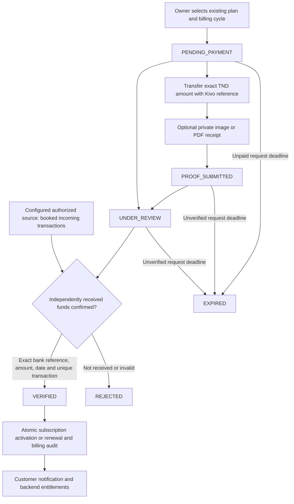

# Bank transfer billing and paywall audit

For the latest fixes, browser evidence and release gates, see
[Bank transfer production readiness](BANK_TRANSFER_PRODUCTION_READINESS.md).
The validation section below records the initial implementation run and is
superseded by that production review.

## Implemented flow

Kivo checkout uses **Bank transfer (Virement bancaire)**. Default RIB:
`2519 0000 0001 5085 8272`. Bank and beneficiary names are administrator
configuration, with no invented defaults. Amounts are priced on the server in
TND with three decimal places. Each payment has an immutable unique reference
and a snapshot of the destination RIB.



Submitting a receipt, refreshing the page, calling the retired Konnect webhook,
or changing browser flags cannot grant paid access. Receipts remain untrusted
documents. Existing trials and historical free/legacy access remain available
under the original policy.

## Architecture and changed files

Existing flow: `billing/service.py` created Konnect checkout requests;
`billing/api.py` polled the provider and handled a GET callback. Billing was
stored in `CreditFlow Billing Payment`, with one `CreditFlow Subscription` per
Business and prices/entitlements in `CreditFlow Plan`. Signup in `signup.py`
provisions verified owners and trials. Tenant scoping lives in `permissions.py`
and `child_permissions.py`; backend entitlements live in `subscription.py`.
Desk banners in `saas_access.py` and `public/js/saas-access.js` are presentation.
`onboarding.commit_csv` separately checks the `migration` entitlement. Existing
read-only dashboards/reports remain accessible under the read-only policy.

Application changes (relative to `apps/creditflow`):

- `creditflow/billing/{bank,service,api,readiness}.py`
- `creditflow/{hooks,permissions,subscription}.py`
- `creditflow/creditflow/doctype/creditflow_billing_payment/`: existing JSON and
  Python controller; new form and list JavaScript.
- `creditflow/creditflow/doctype/creditflow_subscription/`: JSON and controller.
- New `creditflow/creditflow/doctype/kivo_bank_settings/`,
  `creditflow_bank_transaction/`, `creditflow_billing_audit/`: JSON, controllers,
  and package initialization files.
- `creditflow/public/js/saas-billing.js`
- `creditflow/www/creditflow-payment-return.html`, `creditflow/www/creditflow_payment_return.py` and
  `creditflow/www/creditflow-subscription.html`
- `creditflow/tests/{test_billing_konnect,test_billing_requests,test_saas_access_enforcement}.py`
- This operational report.

Historical provider symbols remain for compatibility; direct provider payment,
polling and network methods fail closed. Diagnostics mark Konnect retired.
They are not invoked by active checkout, customer refresh, jobs, or callbacks.
Customer/supplier payment modes and accounting ledgers are unrelated to SaaS
billing and were preserved. Pre-existing deployment/documentation edits were
left intact.

## Database rollout

Run the existing Frappe migration on the target site after backing up, then
build the creditflow assets and restart web/worker processes through the existing
deployment process. Migration was executed on `kivo-fix001-tests.localhost` only.

```sh
bench --site <site> migrate
bench build --app creditflow
```

DocType schema synchronization creates the Settings singleton, transaction
ledger and audit table, adds receipt/review/request deadline fields to Billing
Payment, adds the subscription reminder marker, and adds unique constraints
for transaction keys and payment-to-transaction links. Scheduler synchronization
registers the hourly reconciliation and daily maintenance jobs. No historical
payment status or subscription pricing is rewritten; no payment records are
deleted. No data backfill patch is necessary.

Pending historical Konnect requests need operational investigation with the
old provider, including any refund obligations. The retired callback does not
activate them. Do not relabel old records as bank transfers.

## Configuration

In Desk, open **Kivo Bank Settings** as a System Manager:

- RIB (default above), bank name and beneficiary name.
- Payment expiry days (default 7).
- Manual review reminder days (default 1).
- Subscription expiration reminder days (default 3).

Policies accept 1–365 days; the RIB must contain 20 digits. Changing the RIB
affects new requests; existing requests retain their destination snapshot.

Site configuration:

```json
{"creditflow_paid_checkout_enabled": 1}
```

No banking credentials or new environment variables are required for manual
verification. Ensure the existing Redis, scheduler and workers run. Notifications
use native transactional Notification Logs, independent of SMTP delivery.

### Authorized reconciliation adapter

Automatic bank verification is **not operational by default**. No official bank
API credentials or authorized bank export were supplied, and no bank endpoint
is fabricated. An integration must be implemented and vetted against the actual
bank's authorized data source before this optional site setting is enabled:

`creditflow_bank_reconciliation_adapter`: installed-app Python function path.

The zero-argument function returns normalized records with:

| Field | Contract |
|---|---|
| `transaction_id` | Stable, case-sensitive identifier of an actual bank transaction, at most 140 characters |
| `reference` | Exact Kivo transfer reference |
| `amount` | Exact decimal TND amount, at most three decimal places |
| `currency` | `TND` |
| `transaction_date` | Actual received bank date/time in the site's timezone; cannot be future-dated |
| `destination_account` | Actual destination RIB where available |
| `direction` | `CREDIT`, independently established by the bank source |
| `bank_status` | `BOOKED`, independently established by the bank source |

Use bank-authorized reads; never consume customer receipt uploads as statements.
Keep credentials in protected server configuration and never return them in
normalized records. Use stable identifiers, bounded fetches and overlapping
lookback windows. Do not advance an external cursor before the local transaction
commits. Source exceptions are logged without raw bank data or secret exception
text; the next scheduled run can retry. Records without booked incoming status
cannot activate a subscription. Only internal server code can reconcile records;
no customer statement-ingestion endpoint exists.

Transactions are globally deduplicated by bank transaction identifier, across
sources and manual verification. Integrations must not manufacture identifiers
or use a statement line number. Unknown references, amount/date/destination
mismatches, extra transfers and conflicting records require investigation.
Review unmatched records in the **CreditFlow Bank Transaction** Desk list.

## Admin verification

1. Sign in as an independent System Manager. Open the **CreditFlow Billing
   Payment** Desk list; use **Awaiting review**.
2. Open a payment and select **Review details and audit**. Inspect the Business,
   payer, expected plan/amount/reference, private receipt and billing history.
3. Check the actual received funds using authorized bank records. A receipt,
   screenshot or customer assertion is insufficient.
4. Select **Verify received funds**. Enter the bank transaction ID, actual amount,
   received date, exact reference and destination account where available.
   Confirm the independent funds check and record its method in admin notes.
5. Kivo verifies the match and credits the subscription atomically. The unique
   bank transaction cannot credit another request. Repeating the same approval
   does not extend access twice.
6. Use **Mark under review** or **Reject** when appropriate. Rejection requires
   notes. Admins cannot review payments they requested/created or payments for
   their assigned Business.

Monthly/annual periods remain one/twelve calendar months. Early renewals extend
from the existing paid end and preserve current access. Plan changes remain
blocked during a paid period for another plan. Cancellation keeps access through
the current period end; it does not cancel the payment history. Late funds on
an expired request require independent investigation and a new agreed request;
there is no automatic expired-payment override or refund implementation.

## Paywall fixes and security

- Mutation checks now cover cancellation, deletion, updates after submission and
  `Document.db_set`, in addition to normal saves and REST calls.
- Non-admin entitlement edits are denied even on ignored-permission saves;
  narrowly scoped internal billing operations retain cancellation capability.
- Subscription `db_set` invalidates request caches so revocations take effect.
- Provider-managed ACTIVE subscriptions without paid ends, future periods and
  expired/cancelled periods deny writes independently of browser state/jobs.
- Bank request/transaction/audit writes go through an internal ContextVar
  capability; client-supplied document flags cannot grant it.
- Receipts use private File storage, PNG/JPEG/PDF validation, a 5 MiB limit and
  attachment integrity guards against public conversion or reattachment through
  generic File APIs. SVG and active/embedded PDF content are rejected.
- Sensitive endpoints use native Frappe rate limits and server authorization.
- Failed manual review attempts use deferred, sanitized Error Logs that survive
  request rollback; successful transitions and approval replays use Billing Audit.
- Business/payment/subscription row locks, unique transaction constraints and
  database savepoints make verification atomic and replay safe. Database
  deadlocks retain their retryable error; repeat the same approval safely.

Existing Businesses without subscriptions retain LEGACY_ACCESS; administrator
managed perpetual subscriptions without a provider remain supported. These are
explicit compatibility policies, not payment proof. Administrator privileges
remain a trusted boundary. Seeded plans have no new premium feature taxonomy;
the existing feature mapping and read-only access policy were preserved.

## Validation and limitations

The dedicated test site ran these commands (module runs used `--lightmode`):

```sh
bench --site kivo-fix001-tests.localhost run-tests --module creditflow.tests.test_billing_konnect --lightmode
bench --site kivo-fix001-tests.localhost run-tests --module creditflow.tests.test_billing_requests --lightmode
bench --site kivo-fix001-tests.localhost run-tests --app creditflow --lightmode
git diff --check
```

The full app run executed 549 tests in 141.076 seconds: **548 passed, one failed**.
The failure, `test_payment_receipt_contains_operational_payment_data`, reproduced
in isolation: its unchanged assertion expects `Cheque`, while the unchanged
operational Payment Receipt template renders `CHEQUE`. These are customer debt
payment receipts, not SaaS bank transfer proofs. No unrelated formatting fix was
included. Full output: `/tmp/kivo-bank-full-tests.log`.

Final focused bank verification passed **25 lifecycle tests** in 7.506 seconds
and **11 real HTTP tests** in 6.727 seconds. The extra regressions after the full
app run cover legacy gateway instructions, sanitized failure logs and valid
image receipts. Separate paywall/foundation/permission/signup runs passed
69 tests. Tests include service lifecycle,
real HTTP authorization/REST forgery/rate limits, private downloads, actual
concurrent database requests, injected rollback, reconciliation source outage,
retries, renewal and expiration. JavaScript syntax, Jinja parsing and diff
whitespace checks were run. No live bank source or browser UI was validated.

Receipt validation is not an antivirus service. Documents must be treated as
untrusted when opened; opening a receipt is never sufficient payment evidence.
Notifications are native in-app alerts; guaranteed email/SMS delivery and bank
refund/dispute processing are outside this workflow. Production deployment and
live bank connectivity were not performed.
